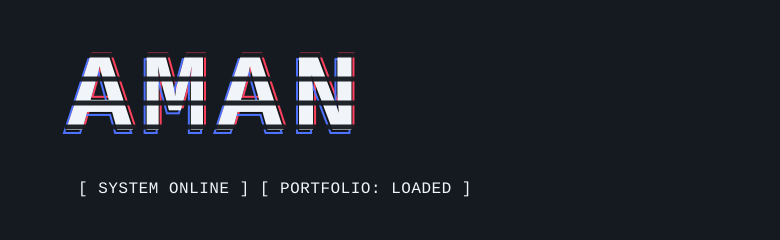
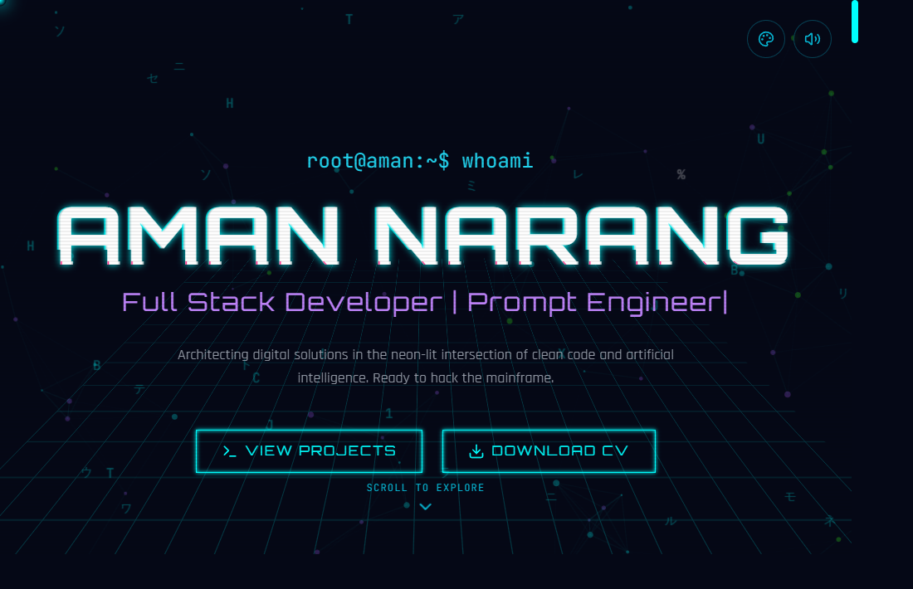

# `AMAN_NARANG.exe` // Cyberpunk Portfolio

<div align="center">



### A neon-soaked portfolio from the edge of the matrix.

**Full Stack Developer · Prompt Engineer · Digital Builder**

[](https://amanweb-lemon.vercel.app)

</div>

---

<div align="center">

### `LIVE INTERFACE // FIRST CONTACT`

<a href="https://amanweb-lemon.vercel.app">
  
</a>

*Click the preview to launch the live portfolio.*

</div>

---

## `> whoami`

A personal portfolio built as a playful cyberpunk interface: terminal-inspired visuals, neon accents, animated sections, and a timeline for projects, skills, education, and experience.

## `> features --all`

- **Animated hero** with a typewriter terminal intro and quick links to projects and the CV.
- **Portfolio sections** for About, Tech Stack, Projects, Experience, Skills, and Contact.
- **GitHub-powered projects** with a fallback project list if live project data is unavailable.
- **Motion-rich UI** using Framer Motion, including animated section entrances and interactive project cards.
- **Personalization controls** including theme switching, sound toggle, and a custom cursor.
- **Hidden interactions** including a Konami-code effect and terminal easter egg.
- **Responsive navigation** with a mobile menu.
- **Vercel Analytics** integration.

## `> tech --stack`

| Layer | Tools |
| --- | --- |
| UI | React 19, JavaScript, Tailwind CSS |
| Build | Vite, TypeScript compiler |
| Motion & interaction | Framer Motion, Vanilla Tilt |
| Icons & visuals | Lucide React, React Icons, Chart.js |
| Audio | Howler |
| Hosting & analytics | Vercel, Vercel Analytics |

## `> boot --local`

### Requirements

- Node.js (a current LTS release is recommended)
- npm

### Start the dev server

```bash
git clone <your-repository-url>
cd <repository-folder>
npm install
npm run dev
```

Vite prints the local URL in your terminal—usually `http://localhost:5173`.

### Build and preview

```bash
npm run build
npm run preview
```

The production build is generated in `dist/`.

## `> map --project`

```text
src/
├── App.jsx                 # Page assembly and global effects
├── components/             # Portfolio sections and UI components
├── config/themes.js        # Theme configuration
├── hooks/                  # Reusable React hooks
├── utils/                  # Shared utilities, including sound
├── index.css
└── style.css
public/                     # Static files, icons, and downloadable CV
```

## `> deploy --vercel`

Import the Git repository into Vercel and deploy with the detected Vite settings. After connecting the repository, pushing a commit to the configured production branch (commonly `main`) triggers a new production deployment.

To update the live portfolio:

```bash
git add .
git commit -m "Describe your portfolio update"
git push origin main
```

Check the latest deployment in **Vercel → Project → Deployments**. It should show **Ready** and **Production** for the production site.

## `> customize`

- Update the timeline content in `src/components/Experience.jsx`.
- Edit the hero introduction in `src/components/Hero.jsx`.
- Adjust theme definitions in `src/config/themes.js`.
- Replace the downloadable resume in `public/` and update the CV component if its filename changes.
- Update the GitHub project-fetching hook and its fallback content to personalize the projects section.

---

<div align="center">

`END OF TRANSMISSION`  ·  Built with React, caffeine, and a suspicious amount of cyan.

</div>
